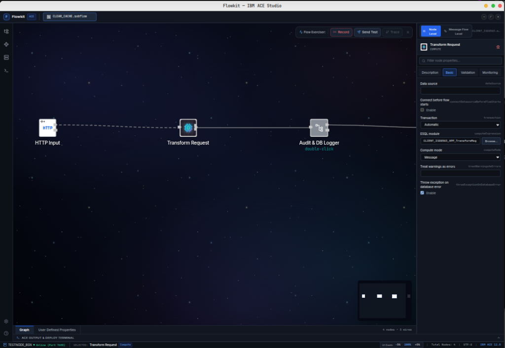
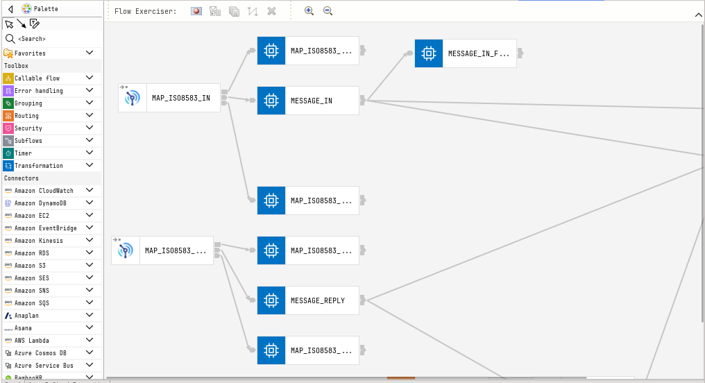
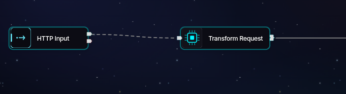

<div align="center">

# ⚡ Flowkit — IBM App Connect Enterprise (ACE) Studio

**Modern, Standalone Visual Studio & ESQL Editor for IBM App Connect Enterprise v11 & v12**

[](https://ultramarshall.github.io/flowkit/)
[](https://github.com/ultramarshall/flowkit-master/releases)
[](https://ultramarshall.github.io/flowkit/#download)
[](LICENSE)

🌐 **Live Product Website & Feature Showcase:**  
👉 **[https://ultramarshall.github.io/flowkit/](https://ultramarshall.github.io/flowkit/)**

---

### 🖥️ Application Overview


</div>

---

## 📦 Unduh Installer Binary (Official Desktop Releases)

Flowkit didistribusikan secara eksklusif dalam format **installer binary native** yang telah diproteksi (*obfuscated & asar packaged*). Tidak ada dependensi node, kompilasi manual, atau arsip sumber kode `.tar.gz`.

| Platform / Sistem Operasi | Format Binary | Arsitektur | Tautan Unduhan Langsung |
| :--- | :--- | :--- | :--- |
| **Linux (Debian / Ubuntu / Mint)** | **`.deb`** Installer | `amd64 / x86_64` | [📥 Unduh flowkit_0.1.0_amd64.deb](https://github.com/ultramarshall/flowkit-master/releases/download/v0.1.0-alpha/flowkit_0.1.0_amd64.deb) |
| **Linux Universal (Arch/Fedora/RHEL)** | **`.AppImage`** Portable | `x86_64` | [📥 Unduh Flowkit-0.1.0.AppImage](https://github.com/ultramarshall/flowkit-master/releases/download/v0.1.0-alpha/Flowkit-0.1.0.AppImage) |
| **Microsoft Windows (10 & 11)** | **`.exe`** NSIS Installer | `x64` | [📥 Unduh Flowkit-Setup-0.1.0.exe](https://github.com/ultramarshall/flowkit-master/releases/download/v0.1.0-alpha/Flowkit-Setup-0.1.0.exe) |
| **Apple macOS (Silicon & Intel)** | **`.dmg`** Disk Image | `Universal` | [📥 Unduh Flowkit-0.1.0.dmg](https://github.com/ultramarshall/flowkit-master/releases/download/v0.1.0-alpha/Flowkit-0.1.0.dmg) |

---

## 📸 Capture Fitur Unggulan (Feature Showcase)

### 1. Right-Click Precision Node Alignment (Rata X & Rata Y)
Rapikan graf alur pesan tanpa dragging manual. Seleksi node, klik kanan, dan pilih alignment instan (Rata Kiri, Rata Tengah, Rata Kanan, Rata Atas, Rata Bawah, serta Sebar Merata).

<div align="center">
  
</div>

---

### 2. Live Integration Server Explorer (Admin REST API v2)
Panel explorer bergaya dockable VSCode untuk memonitor Integration Node (`CORENODE`) dan Server (`RANODE`). Mulai, hentikan, restart message flow, serta deploy BAR langsung secara visual.

<div align="center">
  
</div>

---

### 3. Dynamic Side-Labels & Touchpad Panning
Pilihan mode label samping yang melebar dinamis mengikuti panjang label node dengan icon flush tanpa batas, didukung navigasi touchpad dua jari untuk pan bebas di seluruh kanvas.

<div align="center">
  
</div>

---

## 🚀 Panduan Instalasi Cepat

### Linux (Ubuntu / Debian / Mint)
```bash
sudo dpkg -i flowkit_0.1.0_amd64.deb
flowkit
```

### Linux Portable (AppImage)
```bash
chmod +x Flowkit-0.1.0.AppImage
./Flowkit-0.1.0.AppImage
```

### Windows (10 / 11)
1. Unduh `Flowkit-Setup-0.1.0.exe`.
2. Jalankan berkas installer dan ikuti petunjuk wizard.
3. Buka Flowkit melalui Desktop Shortcut atau Start Menu.

### Apple macOS
1. Unduh `Flowkit-0.1.0.dmg`.
2. Buka berkas `.dmg`, lalu tarik (*drag*) icon **Flowkit** ke folder **Applications**.
3. Buka Flowkit dari Launchpad atau Spotlight (`Cmd + Space`).

---

## 📄 Lisensi
Dilisensikan di bawah [MIT License](LICENSE).
Dikembangkan untuk modernisasi dan akselerasi operasional middleware IBM App Connect Enterprise.
